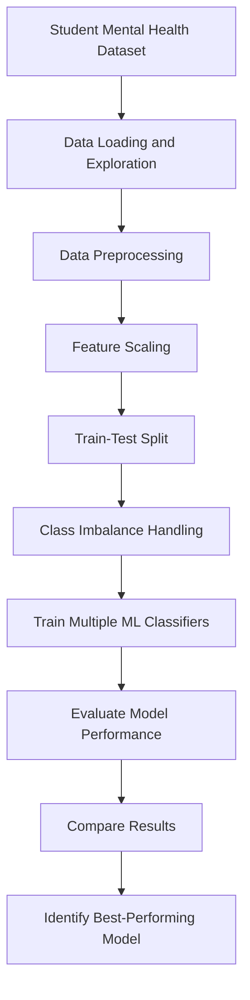

# 🎓 Student Mental Health & Burnout Prediction Using Machine Learning

<div align="center">

**A Machine Learning Approach to Understanding Student Mental Health and Burnout**

[](https://www.python.org/)
[](https://scikit-learn.org/)
[](https://colab.research.google.com/)
[](https://github.com/Tuhfa2512/Student-Burnout-Prediction-Using-Machine-Learning)

**Course:** CSE437 — Group 29

</div>

---

## 📌 Abstract & Overview

Student mental health and burnout are important concerns in modern education. Academic pressure, stress, and other student-related factors can affect well-being and academic performance.

This project applies machine learning techniques to analyze student mental health and burnout-related data. Multiple classification algorithms are trained and evaluated to compare their predictive performance.

The project explores data preprocessing, feature scaling, model training, class resampling, and performance evaluation using several machine learning classifiers.

The main objective is to compare different models and identify which performs best on the selected evaluation metrics.

## 🎯 Project Objectives

- Explore student mental health and burnout-related data.
- Prepare data for machine learning through preprocessing.
- Apply feature scaling and handle class imbalance.
- Train and compare multiple classification algorithms.
- Evaluate model performance using accuracy, precision, recall, F1-score, ROC-AUC, and confusion matrices.
- Identify the best-performing model among the evaluated classifiers.

## 🏗️ System Architecture



## ⚙️ Machine Learning Workflow

### 1. Data Loading and Exploration
Load the dataset and explore its structure, variables, and distributions.

### 2. Data Preprocessing
Prepare the data for modeling and separate the input features from the target variable.

### 3. Feature Scaling
Use `StandardScaler` to standardize numerical features where appropriate.

### 4. Train-Test Split
Divide the data into training and testing subsets to evaluate model performance on held-out data.

### 5. Class Imbalance Handling
Apply resampling to the training data to address class imbalance.

### 6. Model Training
Train multiple classification algorithms using the prepared data.

### 7. Model Evaluation
Compare the classifiers using accuracy, precision, recall, F1-score, ROC-AUC, and confusion matrices.

## 🤖 Models Evaluated

The notebook compares the following machine learning algorithms:

| Model | Purpose |
|---|---|
| Logistic Regression | Linear classification baseline |
| K-Nearest Neighbors (KNN) | Neighbor-based classification |
| Decision Tree | Rule-based classification |
| Random Forest | Ensemble of decision trees |
| Multi-Layer Perceptron (MLP) | Neural network classifier |
| Gaussian Naive Bayes | Probabilistic classification |
| Gradient Boosting | Sequential boosting ensemble |
| AdaBoost | Adaptive boosting |
| Linear SVM | Linear decision boundary |
| RBF SVM | Nonlinear classification |
| XGBoost | Gradient-boosted decision trees |

## 📊 Model Performance

The following accuracy results are recorded in the notebook.

| Rank | Model | Accuracy |
|---:|---|---:|
| 1 | XGBoost | 66.02% |
| 2 | Random Forest | 65.76% |
| 3 | Gradient Boosting | 63.77% |
| 4 | MLP | 56.46% |
| 5 | Decision Tree | 54.69% |
| 6 | SVM RBF | 53.55% |
| 7 | AdaBoost | 52.60% |
| 8 | Naive Bayes | 50.22% |
| 9 | Logistic Regression | 49.90% |
| 10 | KNN | 49.01% |
| 11 | SVM Linear | 47.80% |

*Note: These are the recorded notebook results. Performance may vary with data preparation, resampling, model configuration, and evaluation settings.*

### Evaluation Metrics

- **Accuracy:** Proportion of predictions that are correct.
- **Precision:** Proportion of positive predictions that are correct.
- **Recall:** Proportion of actual positive cases identified.
- **F1-score:** Harmonic mean of precision and recall.
- **ROC-AUC:** Measures how well a model separates the two classes across decision thresholds.
- **Confusion Matrix:** Shows correct and incorrect predictions by class.

**Important:** Accuracy alone does not establish that a model is reliable. The recorded ROC-AUC values are close to 0.5, so further investigation of class imbalance, data splitting, and model evaluation is warranted before drawing strong conclusions.

## 🛠️ Technology Stack

| Category | Tools |
|---|---|
| Programming Language | Python |
| Data Processing | Pandas, NumPy |
| Machine Learning | Scikit-learn, XGBoost |
| Data Visualization | Matplotlib, Seaborn |
| Preprocessing | StandardScaler |
| Evaluation | Scikit-learn metrics |
| Development Environment | Google Colab / Jupyter Notebook |

## 📂 Repository Structure

```text
Student-Burnout-Prediction-Using-Machine-Learning/
│
├── CSE437_Group29_Student_Mental_Health_Burnout.ipynb
│   └── Complete machine learning workflow
│
├── CSE437_Group29 (1).pdf
│   └── Project report
│
└── README.md
    └── Project documentation
```

## 🚀 Getting Started

### Prerequisites

- A Google account
- Access to Google Colab
- Basic knowledge of Python and machine learning

### Run the Project Using Google Colab

**Step 1:** Open the [project notebook](https://github.com/Tuhfa2512/Student-Burnout-Prediction-Using-Machine-Learning/blob/main/CSE437_Group29_Student_Mental_Health_Burnout.ipynb).

**Step 2:** Select **Open in Colab** if available, or download the notebook and upload it to [Google Colab](https://colab.research.google.com/).

**Step 3:** Ensure that the dataset link used in the notebook is accessible to your Google account.

**Step 4:** Run the notebook cells in order, including the data preparation, model training, and evaluation steps.

**Step 5:** Review the model comparison tables, evaluation metrics, and confusion matrices.

### Required Libraries

The notebook uses libraries including:

```python
import pandas as pd
import numpy as np
import matplotlib.pyplot as plt
import seaborn as sns

from sklearn.model_selection import train_test_split, GridSearchCV
from sklearn.preprocessing import StandardScaler
from sklearn.ensemble import RandomForestClassifier
from sklearn.linear_model import LogisticRegression
from sklearn.neural_network import MLPClassifier
```

Additional classifiers and evaluation libraries are used in later notebook cells.

## 🔍 Key Findings

- XGBoost achieved the highest recorded accuracy among the evaluated models.
- Random Forest achieved the second-highest recorded accuracy.
- Gradient Boosting ranked third in the accuracy comparison.
- The ROC-AUC results indicate that further evaluation and validation are necessary.
- Model selection should consider multiple metrics rather than accuracy alone.

## 🔮 Future Improvements

- Investigate class imbalance and target-variable distribution.
- Validate the data-splitting and resampling pipeline.
- Improve model tuning and feature selection.
- Add feature-importance analysis and explainable AI methods.
- Evaluate generalization using cross-validation.
- Improve the model's ability to distinguish between target classes.

## 👥 Authors

- **Nishat Tasnim Luba** — Department of Computer Science & Engineering, BRAC University, Dhaka, Bangladesh (`nishat.tasnim.luba@g.bracu.ac.bd`)
- **Nazifa Tahsin** — Department of Computer Science & Engineering, BRAC University, Dhaka, Bangladesh (`nazifa.tahsin@g.bracu.ac.bd`)
- **Nabilah Hossain** — Department of Computer Science & Engineering, BRAC University, Dhaka, Bangladesh (`nabilah.hossain@g.bracu.ac.bd`)
- **Tasneem Tuhfa** — Department of Computer Science & Engineering, BRAC University, Dhaka, Bangladesh (`tasneem.tuhfa@g.bracu.ac.bd`)

## 📄 Disclaimer

This is an academic machine learning project. Its predictions should not be used as a medical diagnosis or as a substitute for assessment by qualified mental health professionals.

---

<div align="center">

**Student Mental Health & Burnout Prediction Using Machine Learning**

</div>
